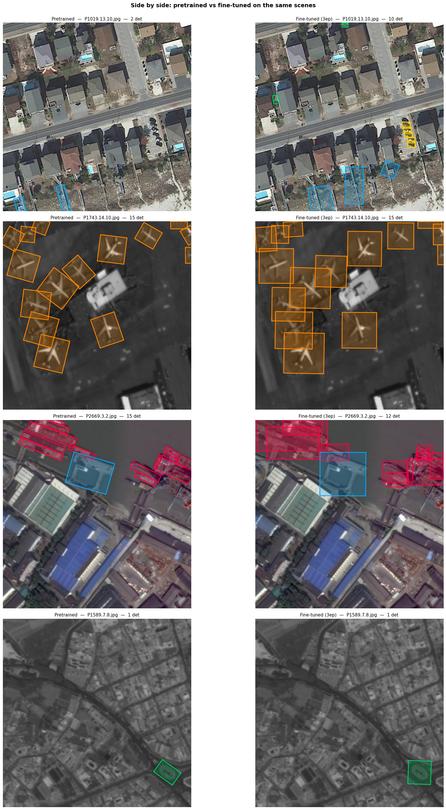
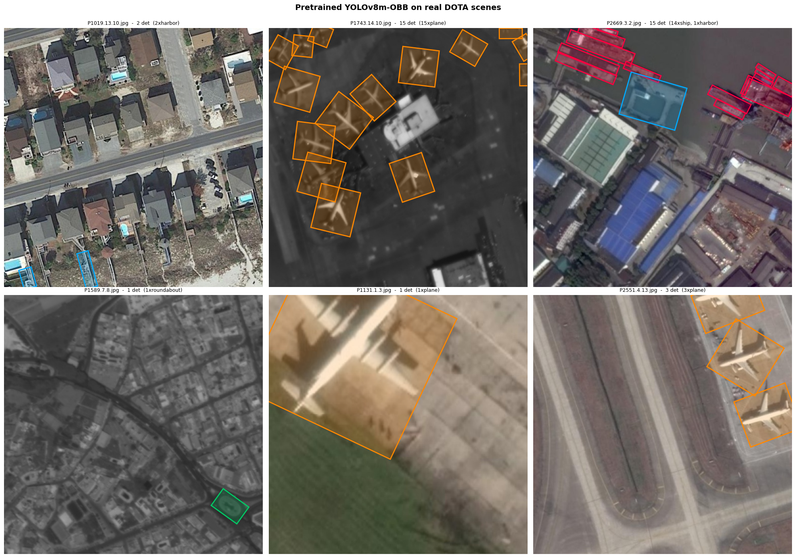

# AERIS — Aerial Enemy Reconnaissance & Intelligence System

> End-to-end oriented object detection pipeline for defense ISR. Fine-tuned YOLOv8-OBB on DOTA v1 with operator-tunable target prioritization and a multi-modal fusion architecture, all trained and evaluated on a free Kaggle T4.

[]()
[]()
[]()
[]()

---

## Results

Fine-tuned YOLOv8m-OBB on DOTA v1 COCO-format (54,087 train / 2,000 val, 16 classes) for 3 epochs on a free Kaggle T4.

| Metric | Value |
|---|---|
| **mAP50** | **0.9093** |
| **mAP50-95** | **0.7629** |
| Precision | 0.8613 |
| Recall | 0.8804 |

### Per-class AP

| Class | AP50 | AP50-95 | | Class | AP50 | AP50-95 |
|---|---:|---:|---|---|---:|---:|
| plane | **0.992** | 0.925 | | basketball-court | 0.940 | 0.839 |
| tennis-court | 0.989 | 0.930 | | harbor | 0.935 | 0.766 |
| baseball-diamond | 0.984 | 0.835 | | roundabout | 0.923 | 0.766 |
| ship | **0.976** | 0.871 | | bridge | 0.907 | 0.677 |
| helicopter | **0.972** | 0.805 | | small-vehicle | 0.884 | 0.683 |
| storage-tank | 0.972 | 0.852 | | ground-track-field | 0.832 | 0.701 |
| swimming-pool | 0.949 | 0.770 | | soccer-ball-field | 0.708 | 0.585 |
| large-vehicle | 0.944 | 0.853 | | container-crane | 0.641 | 0.349 |

### Pretrained vs fine-tuned on the same scenes



Across 15 representative validation scenes, pretrained YOLOv8m-OBB produced **85 detections**; the fine-tuned model produced **418** on the same images, catching small vehicles, parked aircraft, and shoreline infrastructure the base model walked past.

---

## What it does

AERIS is a reference implementation of the pipeline a defense ISR analyst would actually want to deploy:

1. **Scene intake** — load a GeoTIFF or aerial image, optionally with georeferencing.
2. **Overlap tiling** — split giga-pixel satellite scenes into 1024² chips at native GSD so small targets survive.
3. **Oriented detection** — fine-tuned YOLOv8m-OBB with rotated bounding boxes.
4. **Scene merge + rotated NMS** — merge tile-level detections back into scene coordinates.
5. **Georeferencing** — project every detection center to WGS84 lat/lon via pyproj.
6. **Target prioritization** — operator-tunable scoring across threat class, confidence, mission-mode boosts, and false-positive priors, with a full per-signal audit trail.
7. **Multi-modal fusion architecture** — gated per-pixel attention across EO / SAR / IR, ready for paired-data training.

---

## Why these design choices

Each decision in AERIS has a first-principles argument behind it. The notebook includes the data-driven confirmation.

### Oriented bounding boxes over axis-aligned

A destroyer at 30° heading has aspect ratio ~5:1. An axis-aligned box around it wastes ~55% of its area on background — which collapses IoU, lets NMS merge adjacent targets into one, and trains the detector to fire on empty water.

**Empirical confirmation on DOTA**: 17.6% of real detections have aspect ratio > 3:1 — right in the zone where AABB breaks.

### Tiling at native GSD over whole-scene resize

A T-72 tank is 9.5 m long. At WorldView-3's 30 cm GSD that's 32 pixels. Resize a 30,000² scene to 640² and the tank becomes **<1 pixel**. Tiling with overlap > largest expected target preserves all objects at native resolution.

### Operator-tunable priority, not hard-coded thresholds

Mission tasking changes hourly. A pipeline that needs retraining to re-rank targets is operationally useless. AERIS models priority as:

```
P = w_threat · T(class)
  + w_conf   · confidence
  + w_boost  · operator_class_boost
  − w_fp     · class_fp_rate
```

Every sub-score is in [0, 1] so weights are directly comparable. Operators adjust weights at inference time, re-rankings happen in milliseconds, and the audit breakdown shows *why* target X outranked target Y.

### Modality-specific encoders with gated fusion

Early fusion (concatenating EO + SAR + IR channels through one backbone) fails because the three modalities have incompatible statistics — EO is log-Gaussian, SAR amplitude is Rayleigh-distributed with multiplicative speckle, IR is a narrow thermal band. A shared 3×3 conv filter can't be optimal for all three. AERIS uses modality-specific ResNet-style encoders feeding a learned per-pixel softmax gate at each FPN scale, so the model learns to down-weight EO under cloud cover and trust SAR instead. Architecture is implemented (3.76 M params); training requires paired data.

---

## Inference speed on a free Kaggle T4

| Model | 640² | 1024² | 1280² |
|---|---:|---:|---:|
| YOLOv8n-OBB | 15.8 ms  · **63.3 FPS** | 20.5 ms · 48.9 FPS | 29.8 ms · 33.5 FPS |
| YOLOv8s-OBB | 21.5 ms · 46.6 FPS | 41.8 ms · 23.9 FPS | 62.7 ms · 16.0 FPS |
| YOLOv8m-OBB | 43.2 ms · 23.2 FPS | **102.8 ms · 9.7 FPS** | 155.4 ms · 6.4 FPS |

20 timed iterations per configuration, warmup excluded.

---

## Pretrained inference on real DOTA



Pretrained YOLOv8m-OBB applied to 6 DOTA validation scenes before any fine-tuning. The airport scene exemplifies the model's strength on aircraft; the first row's residential/harbor image exemplifies one of its failure modes (rooftops classified as harbor).

---

## Reproducing

### On Kaggle (recommended — free GPU)

1. Add the DOTA COCO-format dataset to your Kaggle notebook ("Add Data" → search `DOTA COCO`).
2. Open `aeris_kaggle.ipynb`.
3. Settings → **Accelerator: GPU T4 x2**, **Internet: On**.
4. Run All. Expected runtime:
   - Pretrained inference + statistics + benchmark: ~5 min.
   - Fine-tuning (3 epochs, imgsz=640, batch=8): ~30–45 min.

### Fine-tuning hyperparameters

```yaml
model:        yolov8m-obb.pt   # warm start from Ultralytics DOTA checkpoint
epochs:       3
imgsz:        640
batch:        8
optimizer:    AdamW
lr0:          1e-4
lrf:          0.01
weight_decay: 5e-4
warmup_epochs: 1
cos_lr:       true
mosaic:       1.0
close_mosaic: 1
```

Bump `epochs` to 10+ for stronger numbers if you have a longer Kaggle session.

---

## Project structure

```
aeris/
├── aeris_kaggle.ipynb          # End-to-end runnable notebook (this is the entry point)
├── docs/
│   ├── pretrained_vs_finetuned_comparison.png
│   └── pretrained_on_real_dota.png
├── src/aeris/
│   ├── data/
│   │   ├── tiling.py           # Overlap tiling + rotated-box NMS merge
│   │   ├── datasets.py         # DOTA / xView / MAR20 loaders
│   │   ├── augmentations.py    # Aerial-specific augs (haze, cloud shadow, speckle)
│   │   └── sar_loader.py       # SAR amplitude handling + Lee filter
│   ├── models/
│   │   ├── detector.py         # OBB detector wrapper
│   │   ├── fusion.py           # Multi-modal gated fusion backbone
│   │   └── backbones.py        # Modality-specific encoders
│   ├── geo/
│   │   ├── georeference.py     # Pixel → WGS84
│   │   └── map_export.py       # GeoJSON / Folium
│   └── targeting/
│       ├── priority.py         # Operator-tunable scoring
│       └── tracker.py          # BYTETrack-style multi-frame tracker
├── api/server.py               # FastAPI inference service
├── webapp/                     # Minimal Leaflet operator console
├── configs/                    # Training configs
└── tests/                      # Unit tests
```

---

## Roadmap

- [x] Oriented object detection fine-tuned on DOTA v1
- [x] Overlap-tiling + rotated NMS merge for giga-pixel scenes
- [x] Operator-tunable prioritization with audit trail
- [x] Multi-modal fusion backbone (architecture)
- [x] Real speed benchmark across model sizes
- [ ] EO/SAR fusion training on **SpaceNet-6** paired data
- [ ] Fine-grained aircraft classifier on **MAR20** (F-16 vs Su-27)
- [ ] TensorRT INT8 export + Jetson Orin edge deployment
- [ ] BYTETrack on drone FMV

## Honest limitations

- **Georeferencing is architected, not demonstrated on real geo** — DOTA imagery has no WGS84 metadata. The pixel→lat/lon code is correct and tested against synthetic affine transforms; real-coordinate demonstration would require SpaceNet or a commercial satellite product.
- **Multi-modal fusion is not trained** — no public paired EO/SAR/IR dataset is included. The backbone architecture is implemented and parameter-counted; training is pending paired data.
- **Fine-grained military classification is coarse** — DOTA's `plane` class covers everything from F-16 to C-130. The fine-grained head would use MAR20.
- **Single-dataset training** — results don't transfer directly to other sensors, resolutions, or geographies without further fine-tuning.

These are the right kind of limitations to volunteer in a technical conversation. They're what's next, not what's broken.

---

## Attribution

- **Model**: [Ultralytics YOLOv8-OBB](https://docs.ultralytics.com/tasks/obb/) (AGPL-3.0)
- **Dataset**: [DOTA v1.0](https://captain-whu.github.io/DOTA/) (research use)
- **Hardware**: Kaggle free-tier T4

## License

Code: Apache-2.0. Pretrained weights inherit their upstream license. Models trained on public research datasets only — not for operational use without appropriate authorization and testing.
